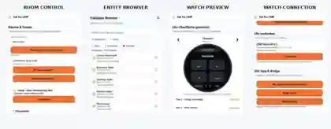

<div align="center">

# HA for CMF

**Home Assistant controls on the CMF Watch Pro 2**

[](https://github.com/AlexRosbach/HA-for-CMF/releases)
[](https://github.com/AlexRosbach/HA-for-CMF/actions/workflows/build.yml)
[](LICENSE)

[**English**](README.md) · [**Deutsch**](README.de.md) · [Releases](https://github.com/AlexRosbach/HA-for-CMF/releases) · [Setup guide](docs/INSTALLATION.md) · [Troubleshooting](docs/TROUBLESHOOTING.md) · [Security](SECURITY.md)

</div>

---

## What is HA for CMF?

HA for CMF is an **experimental, community-developed** Android companion and custom watch application for controlling Home Assistant entities from a **CMF Watch Pro 2**. Your Android phone connects to Home Assistant using your own URL and long-lived token, then bridges commands and states to the watch over Bluetooth Low Energy.

**This is not an official Nothing/CMF or Home Assistant product.** It is not a Wear OS app. A compatible **WP2 Apps custom-app loader** is required on the watch; this project does not flash or replace stock firmware.

### Features

- **Your own watch layout:** up to 6 named pages with 4 customisable tiles each, editable in the phone's interactive circular preview.
- **Controls:** lights, switches, scenes, scripts and buttons; read-only sensors; capabilities may vary by entity.
- **Safety:** lock/unlock requests from the watch require separate approval on the phone. Door-latch release is phone-only with confirmation.
- **Watch navigation:** swipes, crown and arrows; simple category browser for lights, switches, scenes and sensors.
- **Android app:** Home Assistant room view, entity filtering, favourites, pairing and watch setup.
- **Language:** switch between **English and German** in Settings.
- **Appearance:** **System / Light / Dark** themes for the app and connected watch UI.
- **Privacy:** no hosted account required; the Home Assistant token stays on the phone and is stored using Android Keystore-backed encryption.

> [!WARNING]
> This is an **experimental prerelease**. Building the APK and watch package does not prove Bluetooth, loader, or lock behaviour on every real watch/phone. **Do not depend on it as your only way to unlock a door.**

## Screenshots — actual app, anonymised



<sub>Actual Android v0.6 screens provided during testing, cropped and anonymised for public documentation. Original Home Assistant entity IDs, Bluetooth MAC addresses, device-specific names and notification/status-bar content have been replaced with **example values**. These captures are **not** a claim that v0.7 light/dark modes or watch hardware have been validated. See [screenshot policy](docs/SCREENSHOTS.md).</sub>

## Quick start

1. Confirm you have a **CMF Watch Pro 2 with a supported WP2 Apps loader**, an Android 12+ phone and a reachable Home Assistant instance.
2. Download both files from [GitHub Releases](https://github.com/AlexRosbach/HA-for-CMF/releases): the **Android APK** and **`ha-for-cmf.wp2app`**. Keep their versions in sync.
3. Install the APK. In **Settings**, choose **English/Deutsch** and **System/Light/Dark**; add your Home Assistant URL and access token.
4. Open **Watch** to find your watch and install the matching watch package, then create watch pages by tapping tiles in the phone preview.
5. Start the bridge and open the custom watch app. Swipe, use the crown or the arrows to change pages.

For permissions, pairing failures, loader requirements, and signature conflicts, read the [full installation guide](docs/INSTALLATION.md).

> [!NOTE]
> Public CI prerelease APKs currently use an **ephemeral test signing key**. Android may require uninstalling a previous version before installing an update; uninstalling removes saved settings. A persistent release-signing process is a prerequisite for a stable release.

## Compatibility

| Component | Minimum / requirements |
|---|---|
| Android | Android 12+ (API 31+), Bluetooth LE |
| Watch | CMF Watch Pro 2 and a compatible WP2 Apps loader |
| Home Assistant | API reachable from the phone, a long-lived access token |
| Network | HTTPS **required**; HTTP is blocked to protect the access token |
| Watch firmware | Stock firmware alone is not enough for this custom app |

**Not supported:** Wear OS, official Nothing X plugin installation, direct microphone recording from this watch custom app, health sync, guaranteed integration with every lock/scene/entity, and automatic firmware flashing.

## Security and privacy

The Android app uses your local Home Assistant credentials and direct connections; it does **not** run a central HA for CMF cloud service. Treat the phone and BLE bridge as sensitive components: lock operations must be confirmed on your phone, and you should **never put a real token, address, lock name or private household details into public issues or screenshots**. See [Security Policy](SECURITY.md) and [Privacy and permissions](docs/PRIVACY.md).

## Build from source

The repository ships a Rust/no_std watch app and a Java Android app built with Android SDK command-line tools, not Gradle.

```bash
# Watch build: Git, Rust, uv/Python, Nix and supported WP2 toolchain required
rustup target add thumbv7em-none-eabi
bash build.sh

# Android build: JDK 17, Android SDK Platform 35, Build Tools 35
export ANDROID_JAR="$ANDROID_HOME/platforms/android-35/android.jar"
export ANDROID_BUILD_TOOLS="$ANDROID_HOME/build-tools/35.0.0"
export APK_KEYSTORE="/path/to/your/signing.jks"
export APK_KEY_ALIAS="your_alias"
export APK_KEYSTORE_PASSWORD="your_password"
bash android/build.sh
```

Use your **own** signing keystore and keep it outside Git. CI produces **testing** APKs. See [Build and release guide](docs/RELEASE_CHECKLIST.md) for verification steps.

## Documentation

- [Installation / first use](docs/INSTALLATION.md)
- [Common issues and troubleshooting](docs/TROUBLESHOOTING.md)
- [Language and appearance](docs/CONFIGURATION.md)
- [Screenshots: safe contribution checklist](docs/SCREENSHOTS.md)
- [Privacy, permissions and safety](docs/PRIVACY.md)
- [Contributing](CONTRIBUTING.md)
- [Changelog](CHANGELOG.md)
- [Release checklist](docs/RELEASE_CHECKLIST.md)
- [Third-party acknowledgements](THIRD_PARTY_NOTICES.md)

## Contributing and support

Bug reports, translation improvements, tested watch/phone compatibility information and pull requests are welcome. Use [Issues](https://github.com/AlexRosbach/HA-for-CMF/issues) for non-sensitive problems; review [CONTRIBUTING.md](CONTRIBUTING.md) first. Report vulnerabilities **privately** as described in [SECURITY.md](SECURITY.md).

## License

MIT — see [LICENSE](LICENSE). The Nothing, CMF and Home Assistant names and marks belong to their respective owners. This independent project is not affiliated with them. See [THIRD_PARTY_NOTICES.md](THIRD_PARTY_NOTICES.md) before redistributing bundled software.

---

*Developed as a community project. See also [LanLens](https://github.com/AlexRosbach/LanLens), a separate open-source homelab tool by the same maintainer.*
