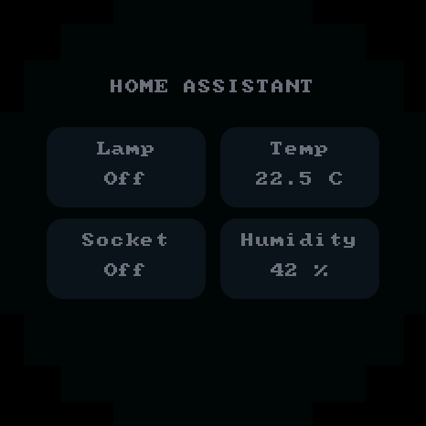

# HA for CMF

Show up to four Home Assistant entities on a CMF Watch Pro 2. Tap a light or switch to turn it on or off. Scenes, scripts, and button entities can be triggered as one-tap actions. Other entities are read-only and can display a state and unit, such as temperature or humidity.



The Android phone loads the entity list from Home Assistant and talks to the watch over Bluetooth LE. The phone is the bridge, including while the screen is locked if the foreground service stays connected. The watch does not need the Home Assistant token.

## v0.5.0 – New Android UI, watch search and phone Assist (experimental)

**What's implemented**
- Four phone tabs: **Zuhause, Entitäten, Uhr, Einstellungen** in a high-contrast light CMF design.
- Fullscreen entity search (name, ID, room, state), sorting, room/type/available/favorites filters and up to 24 watch favorites. Favorites can be reordered in **Entitäten → Favoriten für die Uhr**.
- HA room dashboard and live switch/light control including brightness when supported.
- Settings for Home Assistant URL, long-lived token, and assistant agent. Connection, favorites and assistant ID are encrypted at rest using an AndroidKeyStore AES-GCM key (uninstall clears them).
- Watch search: select **SUCHE** on the watch; turn the crown to choose a letter, tap it to append, use **LOESCHEN** to correct, and tap a result to control an actionable entity. Search queries the phone's Home Assistant catalogue, not just the 24 favorites.
- Watch Assistant: **ASSIST** → type a text question using the crown and press **FRAGEN**, or select **AM HANDY** to post a notification. Tap that notification and speak on the phone. The selected HA conversation agent handles the command and sends text back to the watch.
- Watch lock/unlock requests **never execute from BLE alone**: the phone displays a required notification and confirmation dialog. Physical door unlatching remains phone-only.

**Important limitations**
- The CMF Watch Pro 2 Custom App SDK has no verified microphone-audio API. You cannot dictate into the watch app; voice input is done with Android's speech recognizer on the phone.
- Custom agents (including an OpenAI-backed agent) must already be configured in your Home Assistant instance. A ChatGPT subscription is not an OpenAI API key, and the native Google Assistant app is not a HA conversation agent.
- The UI follows the approved mockups in colors, hierarchy and navigation, but is **not pixel-perfect**; the Android implementation still uses native Java views, not Jetpack Compose. No real-watch screenshots or physical BLE test have been completed.
- Install **both** v0.5 Android and watch packages. The watch requires a compatible WP2 Apps loader. The APK is test-signed in CI, so you may need to uninstall v0.4 before installing v0.5.
- Real hardware/device behavior has not been verified; this release must stay a **prerelease**.

**Setup:** On the phone open **Einstellungen**, enter your HA URL/token, test and load rooms. Open **Entitäten** to choose favorites, then **Uhr** to connect and install the watch app. Start the Bridge. On the watch choose **SUCHE** or **ASSIST** from the bottom navigation.

See the [v0.5 implementation specification](docs/V0.5_IMPLEMENTATION_SPEC.md) for planned follow-up improvements and accessibility test criteria.

## v0.5 design and implementation plan

The complete [v0.5 UI/UX and technical implementation specification](docs/V0.5_IMPLEMENTATION_SPEC.md) covers the approved Android/watch mockups, accessible contrast, room/entity navigation, searchable entities directly on the watch, secure door controls and a realistic Home Assistant Assist integration. **This remains the full design specification; implemented functionality is described in the v0.5 release section above.**

## Connect on Android

1. Your watch must already have the [WP2 Apps firmware and loader](https://github.com/cmf-tech-community/wp2-apps). The Android app installs or updates only the bundled HA for CMF watch app. It does not flash firmware.
2. Download the Android APK from [Releases](https://github.com/AlexRosbach/HA-for-CMF/releases), install it on Android 12 or later, and open **HA for CMF**.
3. Open your Home Assistant profile. Under **Security → Long-lived access tokens**, create a token for the app. Use an HTTPS URL on untrusted networks. Do not share the token. Starting with v0.5, the Android app stores credentials encrypted with AndroidKeyStore until you uninstall the app.
4. In HA for CMF, enter the URL and token. Open **Entitäten**, tap **Alle Entitäten durchsuchen**, search/filter and choose up to 24 favourites. The order in which you select them becomes their order on the watch.
5. Close competing watch apps, such as Nothing X, or disconnect them from the watch. Keep the phone's Bluetooth on. In HA for CMF tap **Uhr suchen**, allow Nearby devices, and select your Watch Pro 2 from the live Bluetooth list. The list also includes bonded and unnamed BLE devices because some watches do not advertise their full retail name.
6. Exit any open WP2 app on the watch. On the phone tap **Install or update watch app**. Wait for success, then dismiss the watch's **Paired** notification if shown.
7. Tap **Bridge starten**. When the phone says it is ready, dismiss the watch's **Paired** prompt and open **Custom Apps → ha-for-cmf**. Use **Bridge stoppen** to end the Bluetooth session or before changing the selection.

Long names and states are shortened for the small display. The initial Android release is experimental, and compatibility with Nothing X running alongside it has not been verified. The watch UI has been tested with a simulated BLE bridge. The Android Bluetooth path still needs a physical phone-to-watch test.

## Build from source

For the watch package, use Git, Python, Rustup, uv, and Nix:

```bash
rustup target add thumbv7em-none-eabi
bash build.sh
```

For Android, install JDK 17, Android SDK Platform 35, and Android Build-Tools 35. Set `ANDROID_JAR` and `ANDROID_BUILD_TOOLS` to their installed paths. Set `APK_KEYSTORE`, `APK_KEY_ALIAS`, and `APK_KEYSTORE_PASSWORD` to your own signing credentials. Run `bash android/build.sh` after building the watch package.

The original single-entity Mac bridge remains available in [v0.1.0](https://github.com/AlexRosbach/HA-for-CMF/releases/tag/v0.1.0).

## Redesigned UI (experimental)

The phone setup now uses cards for pairing, Home Assistant configuration and the bridge. Bluetooth discovery displays live BLE results and paired devices, with progress and scan errors. If the watch has an unexpected name, verify the Bluetooth address before selecting it. The watch display uses a dark CMF-inspired style with orange active tiles and a clear connection state, while retaining the existing one-to-four entity protocol.

**Scope:** This does not add a native Wear OS app or support for heart rate, dimming, or health sync. Home Assistant scenes, scripts and buttons are now available as one-tap actions. The CMF Watch Pro 2 requires the separate WP2 Apps loader and firmware. Physical discovery, pairing, and app installation remain unverified on real hardware; the Android build and watch firmware should be tested before release.


## GitHub Actions test builds

The `Build Android and watch packages` workflow creates an Android APK and the `ha-for-cmf.wp2app` watch package. Open **Actions**, choose the latest successful run, and download the `ha-for-cmf-ci-packages` artifact. The Android APK is **signed with a disposable CI test key**, not the release signing key. It may require uninstalling an older app signed with another key (which clears local app state). Do not enter your Home Assistant access token into a build from an untrusted source.

A green CI build verifies compilation/package generation, **not** that real Watch Pro 2 Bluetooth binding works. Physical device testing is still required before a stable release.

The watch must already have the compatible custom WP2 Apps loader installed. This project does not flash the watch or modify its original firmware.

## Rooms, advanced entity browser and locks (v0.4.0 experimental)

- Open **Favoriten für die Uhr auswählen** to browse entities with multi-term search (name, ID, room, state) and filters for room, type, availability, and favourites. Select up to 24 entities; the watch groups them by Home Assistant room in pages of four. The watch page arrows navigate between rooms.
- **Räume & Geräte** on Android loads live room assignments from Home Assistant using `areas()`, `area_name()`, and `area_entities()` through `/api/template`. Pick a room to see its devices and controls. The first 30 devices are shown in the room view.
- **Lock actions require explicit confirmation.** On Android every unlock and lock action shows a confirmation dialog naming the room and entity, then rechecks its live state. On the watch, the first tap on a lock shows **UNLOCK? / LOCK?** and **TAP AGAIN**; only a second tap within 5 seconds requests the action.
- **Unlock** calls `lock.unlock`; **Tür öffnen (Schnapper)** calls `lock.open` only for locks advertising `LockEntityFeature.OPEN` (`supported_features & 1`). Each action has its own explicit confirmation dialog on Android. The watch deliberately offers only lock/unlock, not physical unlatching.
- Areas not exposed by older Home Assistant versions are grouped under **Ohne Raum**. Filtering and controls still work.
- The launcher now uses an orange app icon, and native Android labels use dark foreground colors on light cards.

Security: The Android app retains your access token in memory for the session only. Do not leave a paired phone unlocked and unattended when adding door locks to watch favourites. Watch lock actions need an active bridge. Test any lock against the correct entity and door before relying on it for access. The new watch and phone versions must be installed together for room page metadata support.

This build is a **pre-release** because real CMF Watch Pro 2 Bluetooth and locking behavior still need device-level verification.
